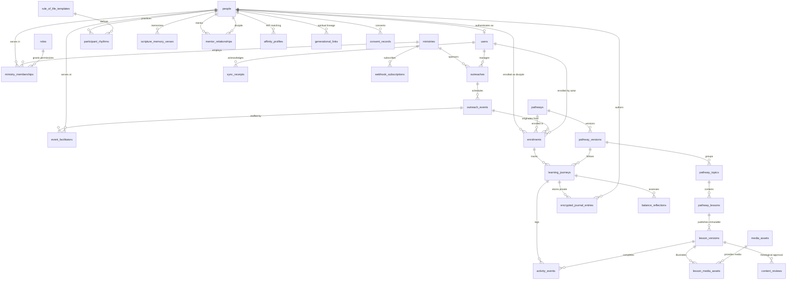

# DATABASE.md --- Canonical Database Schema Specification

**Version:** 2.0  
**Status:** Authoritative Single Source of Truth (SOT) for Application Data Architecture  
**Applies to:** Django/PostgreSQL Backend & React/Dexie.js Offline Client  
**Architecture:** Enterprise Party/Person Decoupled RBAC Relational Schema  
**Last Updated:** October 2026  

---

## 1. Governance, Standards & Enterprise Principles

This document is the **sole authoritative single source of truth** for all database schemas, table names, column definitions, constraints, indexes, foreign key relationships, and client-side offline stores across the Crossway Discipleship Platform.

> [!IMPORTANT]
> **No other document or code file may define alternative database schemas or conflicting table column definitions.** All Django models (`models.py`), migration scripts (`migrations/*.py`), API serializers, and client-side IndexedDB schemas (`Dexie.js`) must strictly conform to the specifications recorded herein.

### 1.1 Enterprise Architectural Standards

1. **Target RDBMS:** PostgreSQL 15+ in production and staging environments. SQLite is strictly prohibited for production testing where relational concurrency, JSONB semantics, or partial indexes are evaluated.
2. **Primary Key Standard:** UUIDv4 (`UUIDField`) is universally mandated for all domain entities. This guarantees client-side offline UUID generation without collision risk, distributed safety, and idempotency across intermittent networks.
3. **Decoupled Party/Person Identity Pattern:**
   - Human identity and personal biodata reside in `people` (`first_name`, `last_name`, `phone_number`, `email`, `date_of_birth`, `city_id`).
   - Authentication credentials and session security reside strictly in `users` (`password_hash`, `is_active`, `is_staff`, `last_login`), linking to `people` via a 1:1 foreign key (`person_id`).
   - This allows outreach attendees, converts, guest facilitators, and children to exist relationally as `people` without requiring premature user account credentials.
4. **First-Class Role-Based Access Control (RBAC):**
   - User permissions within a ministry are governed by an independent `roles` table (`platform_admin`, `ministry_admin`, `missioner`, `mentor`, `content_editor`, `theological_reviewer`) referenced via `role_id` in `ministry_memberships`.
5. **Campaign-Event Hierarchical Outreach Model:**
   - `outreaches` represents the parent campaign (multi-day crusades, community visits, campus drives), defining the delivery channel (`physical`, `virtual`, `hybrid`), default venue/location, and target city.
   - `outreach_events` models individual sessions, dates, or sections within that outreach (e.g., Day 1 Youth Rally, Day 2 Evening Crusade), inheriting parent location with optional session overrides.
   - `event_facilitators` links human servants (`person_id`) directly to events, accommodating visiting/guest ministers without forcing user account creation.
6. **Normalized Event-Level Discipleship Enrolment:**
   - Enrolments are established at the session level (`enrolments.event_id`), directly enabling both event-level and parent outreach-level attendance and attribution rollups.
   - Enrolments reference immutable surrogate keys (`pathway_id`), eliminating fragile string code dependencies.
   - Enrolling actors are captured via `enrolled_by_user_id` (equal to the user's own ID during self-enrolment).
7. **Centralized Media Asset Management:**
   - Lessons support audio, video, and rich illustrations via a centralized `media_assets` library and `lesson_media_assets` junction model, providing checksum-verified offline download calculations, CDN caching, and multi-format accessibility for low-literacy participants.
8. **Auditability & Timestamps:**
   - Every server-side table includes UTC `created_at` (`TIMESTAMPTZ DEFAULT clock_timestamp()`) and `updated_at` (`TIMESTAMPTZ DEFAULT clock_timestamp()`).
9. **Zero-Knowledge Client-Side Encryption (E2EE):**
   - Free-form participant reflections and private pastoral notes are encrypted on the client via the Web Crypto API (`AES-256-GCM`) before transmission.
   - The server stores only ciphertext blobs, initialization vectors (`iv`), and key fingerprints in `encrypted_journal_entries`. The database layer and server administrators have **zero-knowledge** of reflection contents, mathematically preventing data leaks and unauthorized AI prompt ingestion.
10. **Strict Prohibition of Spiritual Scoring Anti-Patterns:**
    - In accordance with `PRODUCT.md` Non-Goals and `BENCHMARK_REVIEW.md` guardrails:
      - **NO** spiritual maturity scores or ratings.
      - **NO** salvation certification flags.
      - **NO** backsliding, unfaithful, or moral risk status labels.
      - **NO** mandatory numerical habit quotas (e.g., minutes prayed or chapters read).
      - **NO** automated punitive inactivity triggers.

---

## 2. Entity-Relationship Overview



---

## 3. Server Database Schema (PostgreSQL)

### 3.1 Domain Module: Identity, People & Access (`identity`)

#### Table: `people`
Django Model: `people.Person`  
Description: Canonical human identity and personal biodata. Decoupled from login credentials.

| Column Name | Data Type | Constraints / Nullable | Default | Description & Safeguarding Notes |
| :--- | :--- | :--- | :--- | :--- |
| `id` | `UUID` | `PRIMARY KEY` | `gen_random_uuid()` | Immutable unique person identifier. |
| `first_name` | `VARCHAR(150)` | `NOT NULL` | - | Given name. |
| `last_name` | `VARCHAR(150)` | `NOT NULL` | - | Family name / surname. |
| `display_name` | `VARCHAR(150)` | `NOT NULL` | `''` | Preferred community/calling name. |
| `email` | `VARCHAR(254)` | `UNIQUE, NULLABLE` | `NULL` | Personal email address (case-insensitive indexed). |
| `phone_number` | `VARCHAR(32)` | `UNIQUE, NULLABLE` | `NULL` | E.164 normalized mobile number. |
| `date_of_birth` | `DATE` | `NULLABLE` | `NULL` | Birthday (strictly used for minor safeguarding verification). |
| `city_id` | `VARCHAR(64)` | `NULLABLE` | `NULL` | Home city / municipality reference. |
| `created_at` | `TIMESTAMPTZ` | `NOT NULL` | `clock_timestamp()` | Entity creation timestamp. |
| `updated_at` | `TIMESTAMPTZ` | `NOT NULL` | `clock_timestamp()` | Entity update timestamp. |

*Indexes & Constraints:*
- `CREATE INDEX idx_people_email ON people(email);`
- `CREATE INDEX idx_people_phone ON people(phone_number);`
- `CONSTRAINT chk_people_contact CHECK (email IS NOT NULL OR phone_number IS NOT NULL OR display_name <> '');`

---

#### Table: `users`
Django Model: `accounts.User`  
Description: Authentication credentials, security state, and platform access accounts.

| Column Name | Data Type | Constraints / Nullable | Default | Description & Safeguarding Notes |
| :--- | :--- | :--- | :--- | :--- |
| `id` | `UUID` | `PRIMARY KEY` | `gen_random_uuid()` | Unique authentication subject ID. |
| `person_id` | `UUID` | `FOREIGN KEY (people.id) ON DELETE CASCADE, UNIQUE NOT NULL` | - | **1:1 link to human identity in `people`.** |
| `email` | `VARCHAR(254)` | `UNIQUE, NOT NULL` | - | Primary login credential. |
| `password_hash` | `VARCHAR(255)` | `NOT NULL` | - | Argon2 / PBKDF2 cryptographic password hash. |
| `is_active` | `BOOLEAN` | `NOT NULL` | `TRUE` | Account active state. |
| `is_staff` | `BOOLEAN` | `NOT NULL` | `FALSE` | Access to operational back-office/admin tools. |
| `is_superuser` | `BOOLEAN` | `NOT NULL` | `FALSE` | Platform administrator override. |
| `last_login` | `TIMESTAMPTZ` | `NULLABLE` | `NULL` | Last successful authentication timestamp. |
| `created_at` | `TIMESTAMPTZ` | `NOT NULL` | `clock_timestamp()` | User account registration timestamp. |
| `updated_at` | `TIMESTAMPTZ` | `NOT NULL` | `clock_timestamp()` | Security update timestamp. |

*Indexes:*
- `CREATE INDEX idx_users_person_id ON users(person_id);`

---

#### Table: `consent_records`
Django Model: `accounts.ConsentRecord`  
Description: Immutable evidence of privacy, terms, mentor pairing, and minor guardian consents.

| Column Name | Data Type | Constraints / Nullable | Default | Description & Safeguarding Notes |
| :--- | :--- | :--- | :--- | :--- |
| `id` | `UUID` | `PRIMARY KEY` | `gen_random_uuid()` | Unique consent receipt ID. |
| `person_id` | `UUID` | `FOREIGN KEY (people.id) ON DELETE CASCADE` | - | Consenting human subject. |
| `consent_type` | `VARCHAR(64)` | `NOT NULL` | - | Enum: `platform_terms`, `privacy_policy`, `mentor_pairing`, `minor_guardian_consent`. |
| `version` | `VARCHAR(32)` | `NOT NULL` | - | Document version string (e.g. `v1.0`). |
| `granted` | `BOOLEAN` | `NOT NULL` | `TRUE` | Consent affirmation status. |
| `ip_address` | `INET` | `NULLABLE` | `NULL` | Anonymized IP hash/address for audit trail. |
| `user_agent` | `TEXT` | `NULLABLE` | `NULL` | Client browser / device user agent string. |
| `created_at` | `TIMESTAMPTZ` | `NOT NULL` | `clock_timestamp()` | Timestamp when consent was actioned. |

---

### 3.2 Domain Module: Organizations, Ministries & RBAC (`organizations`)

#### Table: `roles`
Django Model: `organizations.Role`  
Description: Seeded and extensible Role-Based Access Control (RBAC) definitions.

| Column Name | Data Type | Constraints / Nullable | Default | Description & Safeguarding Notes |
| :--- | :--- | :--- | :--- | :--- |
| `id` | `UUID` | `PRIMARY KEY` | `gen_random_uuid()` | Unique role ID. |
| `code` | `VARCHAR(32)` | `UNIQUE, NOT NULL` | - | Slug: `platform_admin`, `ministry_admin`, `missioner`, `mentor`, `content_editor`, `theological_reviewer`. |
| `name` | `VARCHAR(64)` | `NOT NULL` | - | Human-readable role title. |
| `description` | `TEXT` | `NOT NULL` | `''` | Scope and responsibility documentation. |
| `is_system` | `BOOLEAN` | `NOT NULL` | `TRUE` | System role flag (protected from deletion). |
| `permissions` | `JSONB` | `NOT NULL` | `'[]'` | Granular permission capability keys. |
| `created_at` | `TIMESTAMPTZ` | `NOT NULL` | `clock_timestamp()` | Role creation timestamp. |

---

#### Table: `ministries`
Django Model: `organizations.Ministry`  
Description: Organizational tenant workspace managing outreaches, staff memberships, and aggregate reports.

| Column Name | Data Type | Constraints / Nullable | Default | Description & Safeguarding Notes |
| :--- | :--- | :--- | :--- | :--- |
| `id` | `UUID` | `PRIMARY KEY` | `gen_random_uuid()` | Unique ministry workspace ID. |
| `name` | `VARCHAR(160)` | `NOT NULL` | - | Organizational display name. |
| `slug` | `VARCHAR(160)` | `UNIQUE, NOT NULL` | - | URL-safe identifier for tenant routing. |
| `status` | `VARCHAR(32)` | `NOT NULL` | `'active'` | Enum: `active`, `suspended`, `archived`. |
| `parent_ministry_id`| `UUID` | `FOREIGN KEY (ministries.id) ON DELETE SET NULL, NULLABLE` | `NULL` | Optional parent diocese / network workspace. |
| `settings` | `JSONB` | `NOT NULL` | `'{}'` | Tenant configuration (branding, ChMS hooks). |
| `created_at` | `TIMESTAMPTZ` | `NOT NULL` | `clock_timestamp()` | Creation timestamp. |
| `updated_at` | `TIMESTAMPTZ` | `NOT NULL` | `clock_timestamp()` | Last update timestamp. |

---

#### Table: `ministry_memberships`
Django Model: `organizations.MinistryMembership`  
Description: Scoped association assigning role permissions to a user within a specific ministry workspace.

| Column Name | Data Type | Constraints / Nullable | Default | Description & Safeguarding Notes |
| :--- | :--- | :--- | :--- | :--- |
| `id` | `UUID` | `PRIMARY KEY` | `gen_random_uuid()` | Unique membership record ID. |
| `user_id` | `UUID` | `FOREIGN KEY (users.id) ON DELETE CASCADE` | - | Associated user account. |
| `ministry_id` | `UUID` | `FOREIGN KEY (ministries.id) ON DELETE CASCADE` | - | Scoped ministry tenant. |
| `role_id` | `UUID` | `FOREIGN KEY (roles.id) ON DELETE PROTECT` | - | **Foreign key to seeded `roles` table.** |
| `status` | `VARCHAR(32)` | `NOT NULL` | `'active'` | Enum: `active`, `invited`, `revoked`. |
| `created_at` | `TIMESTAMPTZ` | `NOT NULL` | `clock_timestamp()` | Membership creation timestamp. |
| `updated_at` | `TIMESTAMPTZ` | `NOT NULL` | `clock_timestamp()` | Role update timestamp. |

*Constraints:*
- `UNIQUE (user_id, ministry_id, role_id)`
- `CREATE INDEX idx_ministry_membership_lookup ON ministry_memberships(ministry_id, user_id);`

---

### 3.3 Domain Module: Outreach Campaigns, Events & Facilitators (`outreach`)

#### Table: `outreaches`
Django Model: `outreach.Outreach`  
Description: High-level evangelistic initiative, crusade campaign, or mission drive.

| Column Name | Data Type | Constraints / Nullable | Default | Description & Safeguarding Notes |
| :--- | :--- | :--- | :--- | :--- |
| `id` | `UUID` | `PRIMARY KEY` | `gen_random_uuid()` | Unique outreach campaign ID. |
| `name` | `VARCHAR(160)` | `NOT NULL` | - | Campaign title (e.g. "Greater Lagos Harvest Crusade 2026"). |
| `description` | `TEXT` | `NOT NULL` | `''` | Mission statement and logistical notes. |
| `channel` | `VARCHAR(32)` | `NOT NULL` | `'physical'` | Enum: `physical`, `virtual`, `hybrid`. |
| `virtual_platform`| `VARCHAR(64)` | `NOT NULL` | `''` | Platform if virtual (e.g. `youtube`, `zoom`, `facebook_live`, `radio`, `web`). |
| `location` | `TEXT` | `NOT NULL` | `''` | Default venue address for physical campaigns. |
| `city_id` | `VARCHAR(64)` | `NULLABLE` | `NULL` | Target city / region code. |
| `owner_user_id` | `UUID` | `FOREIGN KEY (users.id) ON DELETE PROTECT` | - | Accountable campaign director. |
| `owner_ministry_id`| `UUID` | `FOREIGN KEY (ministries.id) ON DELETE PROTECT, NULLABLE` | `NULL` | Sponsoring ministry workspace. |
| `status` | `VARCHAR(32)` | `NOT NULL` | `'draft'` | Enum: `draft`, `active`, `completed`, `archived`. |
| `starts_at` | `TIMESTAMPTZ` | `NULLABLE` | `NULL` | Campaign commencement timestamp. |
| `ends_at` | `TIMESTAMPTZ` | `NULLABLE` | `NULL` | Campaign conclusion timestamp. |
| `created_at` | `TIMESTAMPTZ` | `NOT NULL` | `clock_timestamp()` | Creation timestamp. |
| `updated_at` | `TIMESTAMPTZ` | `NOT NULL` | `clock_timestamp()` | Last update timestamp. |

*Constraints:*
- `CONSTRAINT chk_outreach_dates CHECK (ends_at IS NULL OR starts_at IS NULL OR ends_at >= starts_at);`

---

#### Table: `outreach_events`
Django Model: `outreach.OutreachEvent`  
Description: Individual sessions, crusade days, rallies, or follow-up meetings under a parent outreach.

| Column Name | Data Type | Constraints / Nullable | Default | Description & Safeguarding Notes |
| :--- | :--- | :--- | :--- | :--- |
| `id` | `UUID` | `PRIMARY KEY` | `gen_random_uuid()` | Unique event/session ID. |
| `outreach_id` | `UUID` | `FOREIGN KEY (outreaches.id) ON DELETE CASCADE` | - | Parent outreach campaign. |
| `name` | `VARCHAR(160)` | `NOT NULL` | - | Session title (e.g. "Day 1 Evening Gospel Rally"). |
| `kind` | `VARCHAR(48)` | `NOT NULL` | `'crusade'` | Enum: `crusade`, `church_service`, `campus_outreach`, `community_visit`, `follow_up`, `workshop`, `other`. |
| `starts_at` | `TIMESTAMPTZ` | `NULLABLE` | `NULL` | Scheduled session start. |
| `ends_at` | `TIMESTAMPTZ` | `NULLABLE` | `NULL` | Scheduled session end. |
| `location_override`| `TEXT` | `NOT NULL` | `''` | Venue override if different from `outreaches.location`. |
| `stream_url` | `VARCHAR(512)` | `NOT NULL` | `''` | Optional session broadcast URL. |
| `status` | `VARCHAR(32)` | `NOT NULL` | `'scheduled'` | Enum: `scheduled`, `active`, `concluded`, `cancelled`. |
| `created_at` | `TIMESTAMPTZ` | `NOT NULL` | `clock_timestamp()` | Creation timestamp. |
| `updated_at` | `TIMESTAMPTZ` | `NOT NULL` | `clock_timestamp()` | Last update timestamp. |

*Indexes:*
- `CREATE INDEX idx_outreach_events_parent ON outreach_events(outreach_id);`

---

#### Table: `event_facilitators`
Django Model: `outreach.EventFacilitator`  
Description: Assigned ministers, guest evangelists, counselors, and workers serving at specific events.

| Column Name | Data Type | Constraints / Nullable | Default | Description & Safeguarding Notes |
| :--- | :--- | :--- | :--- | :--- |
| `id` | `UUID` | `PRIMARY KEY` | `gen_random_uuid()` | Facilitator assignment ID. |
| `event_id` | `UUID` | `FOREIGN KEY (outreach_events.id) ON DELETE CASCADE` | - | Assigned event session. |
| `person_id` | `UUID` | `FOREIGN KEY (people.id) ON DELETE CASCADE` | - | **Person reference.** Enables guest ministers without user accounts. |
| `role_title` | `VARCHAR(64)` | `NOT NULL` | `'counselor'` | Operational title (e.g. `guest_preacher`, `counselor`, `worship_leader`, `usher`). |
| `notes` | `TEXT` | `NOT NULL` | `''` | Internal coordination notes. |
| `created_at` | `TIMESTAMPTZ` | `NOT NULL` | `clock_timestamp()` | Assignment timestamp. |

*Constraints:*
- `UNIQUE (event_id, person_id, role_title)`

---

### 3.4 Domain Module: Enrolments & Access (`enrolments`)

#### Table: `enrolments`
Django Model: `enrolments.Enrolment`  
Description: Event-level enrolment linking a person to a discipleship pathway and immutable attribution snapshot.

| Column Name | Data Type | Constraints / Nullable | Default | Description & Safeguarding Notes |
| :--- | :--- | :--- | :--- | :--- |
| `id` | `UUID` | `PRIMARY KEY` | `gen_random_uuid()` | Unique enrolment record ID. |
| `person_id` | `UUID` | `FOREIGN KEY (people.id) ON DELETE PROTECT` | - | **Enrolled participant identity.** |
| `pathway_id` | `UUID` | `FOREIGN KEY (pathways.id) ON DELETE PROTECT` | - | **Foreign key to `pathways.id`** (replaces mutable string code). |
| `event_id` | `UUID` | `FOREIGN KEY (outreach_events.id) ON DELETE PROTECT, NULLABLE` | `NULL` | **Originating event session.** Directly attributes event & parent outreach. |
| `enrolled_by_user_id`| `UUID` | `FOREIGN KEY (users.id) ON DELETE PROTECT` | - | **Enrolling actor.** Equals participant's user ID if self-enrolled. |
| `access_invitation_id`| `UUID`| `FOREIGN KEY (access_invitations.id) ON DELETE SET NULL, NULLABLE` | `NULL` | Optional link if redeemed via access code. |
| `source_snapshot`| `JSONB` | `NOT NULL` | - | **Immutable attribution snapshot** (captures campaign/event/ministry names). |
| `consent_version`| `VARCHAR(32)` | `NOT NULL` | - | Consent document version affirmed at enrolment. |
| `status` | `VARCHAR(32)` | `NOT NULL` | `'active'` | Enum: `active`, `completed`, `withdrawn`. |
| `created_at` | `TIMESTAMPTZ` | `NOT NULL` | `clock_timestamp()` | Immutable creation timestamp. |
| `updated_at` | `TIMESTAMPTZ` | `NOT NULL` | `clock_timestamp()` | Status update timestamp. |

*Indexes & Constraints:*
- `UNIQUE (person_id, pathway_id, event_id)`
- `CREATE INDEX idx_enrolments_event ON enrolments(event_id);`
- `CREATE INDEX idx_enrolments_person ON enrolments(person_id);`

---

#### Table: `access_invitations`
Django Model: `enrolments.AccessInvitation`  
Description: Scoped, rate-limited tokens/codes for claiming self-enrolment without sensitive URL parameters.

| Column Name | Data Type | Constraints / Nullable | Default | Description & Safeguarding Notes |
| :--- | :--- | :--- | :--- | :--- |
| `id` | `UUID` | `PRIMARY KEY` | `gen_random_uuid()` | Unique invitation token ID. |
| `code_hash` | `VARCHAR(128)` | `UNIQUE, NOT NULL` | - | SHA-256 hash of redemption code. |
| `event_id` | `UUID` | `FOREIGN KEY (outreach_events.id) ON DELETE CASCADE` | - | Bound outreach event. |
| `pathway_id` | `UUID` | `FOREIGN KEY (pathways.id) ON DELETE CASCADE` | - | Target pathway. |
| `expires_at` | `TIMESTAMPTZ` | `NOT NULL` | - | Token expiration timestamp. |
| `max_claims` | `INTEGER` | `NOT NULL` | `1` | Maximum redemption ceiling. |
| `claim_count` | `INTEGER` | `NOT NULL` | `0` | Successful redemptions to date. |
| `is_revoked` | `BOOLEAN` | `NOT NULL` | `FALSE` | Manual revocation flag. |
| `created_at` | `TIMESTAMPTZ` | `NOT NULL` | `clock_timestamp()` | Token creation timestamp. |

---

### 3.5 Domain Module: Curriculum Taxonomy & Media Assets (`content`)

#### Table: `pathways`
Django Model: `content.Pathway`  
Description: Top-level discipleship tracks (`formation`, `restoration`, `discernment`).

| Column Name | Data Type | Constraints / Nullable | Default | Description & Safeguarding Notes |
| :--- | :--- | :--- | :--- | :--- |
| `id` | `UUID` | `PRIMARY KEY` | `gen_random_uuid()` | Unique pathway ID. |
| `code` | `VARCHAR(32)` | `UNIQUE, NOT NULL` | - | Canonical identifier: `formation`, `restoration`, `discernment`. |
| `title` | `VARCHAR(160)` | `NOT NULL` | - | Display title. |
| `description` | `TEXT` | `NOT NULL` | - | Theological purpose statement. |
| `is_active` | `BOOLEAN` | `NOT NULL` | `TRUE` | Availability flag. |
| `created_at` | `TIMESTAMPTZ` | `NOT NULL` | `clock_timestamp()` | Creation timestamp. |

---

#### Table: `pathway_versions`
Django Model: `content.PathwayVersion`  
Description: Immutable version container for an entire ordered curriculum release.

| Column Name | Data Type | Constraints / Nullable | Default | Description & Safeguarding Notes |
| :--- | :--- | :--- | :--- | :--- |
| `id` | `UUID` | `PRIMARY KEY` | `gen_random_uuid()` | Unique version container ID. |
| `pathway_id` | `UUID` | `FOREIGN KEY (pathways.id) ON DELETE CASCADE` | - | Parent pathway. |
| `version_string`| `VARCHAR(32)` | `NOT NULL` | - | Semantic version string (e.g. `1.0.0`). |
| `status` | `VARCHAR(32)` | `NOT NULL` | `'draft'` | Enum: `draft`, `in_review`, `published`, `retired`. |
| `published_at` | `TIMESTAMPTZ` | `NULLABLE` | `NULL` | Publication timestamp. |
| `created_at` | `TIMESTAMPTZ` | `NOT NULL` | `clock_timestamp()` | Creation timestamp. |

*Constraints:*
- `UNIQUE (pathway_id, version_string)`

---

#### Table: `pathway_topics`
Django Model: `content.PathwayTopic`  
Description: Thematic units grouping lessons (renamed from `content_module`).

| Column Name | Data Type | Constraints / Nullable | Default | Description & Safeguarding Notes |
| :--- | :--- | :--- | :--- | :--- |
| `id` | `UUID` | `PRIMARY KEY` | `gen_random_uuid()` | Unique topic ID. |
| `pathway_version_id`| `UUID` | `FOREIGN KEY (pathway_versions.id) ON DELETE CASCADE` | - | Parent pathway version. |
| `order_index` | `INTEGER` | `NOT NULL` | `0` | Sequential sort position. |
| `title` | `VARCHAR(160)` | `NOT NULL` | - | Topic title. |
| `description` | `TEXT` | `NOT NULL` | `''` | Topic scope and learning objectives. |
| `dimension` | `VARCHAR(24)` | `NOT NULL` | `'balanced'` | Enum: `head`, `heart`, `hands`, `balanced` (GAP-05 Triad). |
| `created_at` | `TIMESTAMPTZ` | `NOT NULL` | `clock_timestamp()` | Creation timestamp. |

---

#### Table: `pathway_lessons`
Django Model: `content.PathwayLesson`  
Description: Logical lesson entity within a topic (renamed from `content_lesson`).

| Column Name | Data Type | Constraints / Nullable | Default | Description & Safeguarding Notes |
| :--- | :--- | :--- | :--- | :--- |
| `id` | `UUID` | `PRIMARY KEY` | `gen_random_uuid()` | Unique lesson identifier. |
| `topic_id` | `UUID` | `FOREIGN KEY (pathway_topics.id) ON DELETE CASCADE` | - | Parent curriculum topic. |
| `slug` | `VARCHAR(160)` | `NOT NULL` | - | URL-safe slug. |
| `order_index` | `INTEGER` | `NOT NULL` | `0` | Sequential sort position within topic. |
| `created_at` | `TIMESTAMPTZ` | `NOT NULL` | `clock_timestamp()` | Creation timestamp. |

*Constraints:*
- `UNIQUE (topic_id, slug)`

---

#### Table: `lesson_versions`
Django Model: `content.LessonVersion`  
Description: **Strictly immutable** published lesson content packet, media links, and theological metadata.

| Column Name | Data Type | Constraints / Nullable | Default | Description & Safeguarding Notes |
| :--- | :--- | :--- | :--- | :--- |
| `id` | `UUID` | `PRIMARY KEY` | `gen_random_uuid()` | Immutable content version ID. |
| `lesson_id` | `UUID` | `FOREIGN KEY (pathway_lessons.id) ON DELETE PROTECT` | - | Parent logical lesson. |
| `version_number`| `INTEGER` | `NOT NULL` | `1` | Monotonically increasing version integer. |
| `title` | `VARCHAR(160)` | `NOT NULL` | - | Versioned lesson title. |
| `learning_objectives`| `JSONB` | `NOT NULL` | `'[]'` | Plain-language measurable outcomes. |
| `content_body` | `TEXT` | `NOT NULL` | - | Markdown lesson text. |
| `primary_media_url`| `VARCHAR(512)`| `NULLABLE` | `NULL` | Primary video/audio stream URL (low-literacy accessible format). |
| `primary_media_type`| `VARCHAR(32)` | `NOT NULL` | `'text_only'`| Enum: `text_only`, `video`, `audio`. |
| `scripture_references`| `JSONB`| `NOT NULL` | `'[]'` | Verified Bible citations (translation, book, verses). |
| `source_metadata`| `JSONB` | `NOT NULL` | `'{}'` | Source author, copyright, and licensing rights. |
| `dimension` | `VARCHAR(24)` | `NOT NULL` | `'head'` | Primary focus: `head`, `heart`, `hands` (GAP-05). |
| `status` | `VARCHAR(32)` | `NOT NULL` | `'draft'` | Enum: `draft`, `in_review`, `approved`, `published`, `retired`. |
| `checksum` | `VARCHAR(64)` | `NOT NULL` | - | SHA-256 payload integrity checksum. |
| `created_at` | `TIMESTAMPTZ` | `NOT NULL` | `clock_timestamp()` | Creation timestamp. |

*Constraints:*
- `UNIQUE (lesson_id, version_number)`

---

#### Table: `media_assets`
Django Model: `content.MediaAsset`  
Description: Centralized media storage registry for illustrations, infographics, audio bibles, and video teachings.

| Column Name | Data Type | Constraints / Nullable | Default | Description & Safeguarding Notes |
| :--- | :--- | :--- | :--- | :--- |
| `id` | `UUID` | `PRIMARY KEY` | `gen_random_uuid()` | Unique media asset ID. |
| `ministry_id` | `UUID` | `FOREIGN KEY (ministries.id) ON DELETE SET NULL, NULLABLE` | `NULL` | Owner ministry (NULL = global platform asset). |
| `title` | `VARCHAR(160)` | `NOT NULL` | - | Asset title. |
| `asset_type` | `VARCHAR(32)` | `NOT NULL` | - | Enum: `image`, `video`, `audio`, `document`. |
| `mime_type` | `VARCHAR(64)` | `NOT NULL` | - | Standard MIME type (e.g. `image/webp`, `audio/aac`). |
| `storage_path` | `VARCHAR(512)` | `NOT NULL` | - | S3/object storage key. |
| `cdn_url` | `VARCHAR(512)` | `NOT NULL` | - | Edge CDN distribution URL. |
| `file_size_bytes`| `BIGINT` | `NOT NULL` | - | Size in bytes (required for offline pack download sizing). |
| `duration_seconds`| `INTEGER` | `NULLABLE` | `NULL` | Duration for audio/video assets. |
| `checksum` | `VARCHAR(64)` | `NOT NULL` | - | SHA-256 checksum for offline integrity validation. |
| `alt_text` | `TEXT` | `NOT NULL` | `''` | Screen-reader accessibility description. |
| `caption` | `TEXT` | `NOT NULL` | `''` | Display caption. |
| `license_metadata`| `JSONB` | `NOT NULL` | `'{}'` | Attribution and copyright licensing terms. |
| `created_at` | `TIMESTAMPTZ` | `NOT NULL` | `clock_timestamp()` | Upload timestamp. |

---

#### Table: `lesson_media_assets`
Django Model: `content.LessonMediaAsset`  
Description: Junction model linking media assets to lesson versions with display ordering and usage roles.

| Column Name | Data Type | Constraints / Nullable | Default | Description & Safeguarding Notes |
| :--- | :--- | :--- | :--- | :--- |
| `id` | `UUID` | `PRIMARY KEY` | `gen_random_uuid()` | Association ID. |
| `lesson_version_id`| `UUID` | `FOREIGN KEY (lesson_versions.id) ON DELETE CASCADE` | - | Bound lesson version. |
| `media_asset_id`| `UUID` | `FOREIGN KEY (media_assets.id) ON DELETE PROTECT` | - | Linked media asset. |
| `usage_role` | `VARCHAR(32)` | `NOT NULL` | `'illustration'` | Enum: `hero`, `illustration`, `diagram`, `audio_narration`, `sign_language_video`. |
| `order_index` | `INTEGER` | `NOT NULL` | `0` | Display presentation sequence. |
| `created_at` | `TIMESTAMPTZ` | `NOT NULL` | `clock_timestamp()` | Link timestamp. |

*Constraints:*
- `UNIQUE (lesson_version_id, media_asset_id)`

---

#### Table: `content_reviews`
Django Model: `content.ContentReview`  
Description: Governance audit record documenting theological and editorial review decisions.

| Column Name | Data Type | Constraints / Nullable | Default | Description & Safeguarding Notes |
| :--- | :--- | :--- | :--- | :--- |
| `id` | `UUID` | `PRIMARY KEY` | `gen_random_uuid()` | Review decision ID. |
| `lesson_version_id`| `UUID` | `FOREIGN KEY (lesson_versions.id) ON DELETE CASCADE` | - | Reviewed lesson version. |
| `reviewer_id` | `UUID` | `FOREIGN KEY (users.id) ON DELETE PROTECT` | - | Qualified theological reviewer. |
| `decision` | `VARCHAR(32)` | `NOT NULL` | - | Enum: `approved`, `rejected`, `changes_requested`. |
| `notes` | `TEXT` | `NOT NULL` | `''` | Theological evaluation and guidance. |
| `decided_at` | `TIMESTAMPTZ` | `NOT NULL` | `clock_timestamp()` | Decision timestamp. |

---

### 3.6 Domain Module: Learning & Progression (`learning`)

#### Table: `learning_journeys`
Django Model: `learning.Journey`  
Description: A participant's progress thread through a versioned pathway.

| Column Name | Data Type | Constraints / Nullable | Default | Description & Safeguarding Notes |
| :--- | :--- | :--- | :--- | :--- |
| `id` | `UUID` | `PRIMARY KEY` | `gen_random_uuid()` | Unique journey progress ID. |
| `enrolment_id` | `UUID` | `FOREIGN KEY (enrolments.id) ON DELETE PROTECT` | - | Bound enrolment record. |
| `pathway_version_id`| `UUID` | `FOREIGN KEY (pathway_versions.id) ON DELETE PROTECT` | - | Pinned curriculum version. |
| `state` | `VARCHAR(32)` | `NOT NULL` | `'not_started'` | Enum: `not_started`, `in_progress`, `completed`, `paused_by_participant`. |
| `started_at` | `TIMESTAMPTZ` | `NULLABLE` | `NULL` | First activity timestamp. |
| `completed_at` | `TIMESTAMPTZ` | `NULLABLE` | `NULL` | Completion timestamp. |
| `last_activity_at`| `TIMESTAMPTZ`| `NULLABLE` | `NULL` | Most recent activity sync timestamp. |
| `created_at` | `TIMESTAMPTZ` | `NOT NULL` | `clock_timestamp()` | Journey creation timestamp. |
| `updated_at` | `TIMESTAMPTZ` | `NOT NULL` | `clock_timestamp()` | State transition timestamp. |

*Indexes:*
- `CREATE INDEX idx_learning_journeys_enrolment ON learning_journeys(enrolment_id);`

---

#### Table: `activity_events`
Django Model: `learning.ActivityEvent`  
Description: Append-only ledger of learning actions synchronized from client devices.

| Column Name | Data Type | Constraints / Nullable | Default | Description & Safeguarding Notes |
| :--- | :--- | :--- | :--- | :--- |
| `event_uuid` | `UUID` | `PRIMARY KEY` | - | Client-generated idempotent event UUID. |
| `person_id` | `UUID` | `FOREIGN KEY (people.id) ON DELETE CASCADE` | - | **Person identity of actor.** |
| `journey_id` | `UUID` | `FOREIGN KEY (learning_journeys.id) ON DELETE CASCADE` | - | Associated journey. |
| `lesson_version_id`| `UUID` | `FOREIGN KEY (lesson_versions.id) ON DELETE PROTECT` | - | Exact version of lesson completed. |
| `event_type` | `VARCHAR(64)` | `NOT NULL` | - | Enum: `lesson_opened`, `step_completed`, `question_answered`, `journey_completed`. |
| `payload_schema_version`| `INTEGER`| `NOT NULL` | `1` | Serialization schema version. |
| `payload` | `JSONB` | `NOT NULL` | - | Structured event data (validated strictly). |
| `client_created_at`| `TIMESTAMPTZ`| `NOT NULL` | - | Client device timestamp at creation. |
| `server_received_at`| `TIMESTAMPTZ`| `NOT NULL` | `clock_timestamp()` | Server receipt and write timestamp. |

*Indexes:*
- `CREATE INDEX idx_activity_events_journey ON activity_events(journey_id, event_type);`

---

#### Table: `assessment_attempts`
Django Model: `learning.AssessmentAttempt`  
Description: Formative comprehension check record.

| Column Name | Data Type | Constraints / Nullable | Default | Description & Safeguarding Notes |
| :--- | :--- | :--- | :--- | :--- |
| `id` | `UUID` | `PRIMARY KEY` | `gen_random_uuid()` | Attempt ID. |
| `event_uuid` | `UUID` | `FOREIGN KEY (activity_events.event_uuid) ON DELETE CASCADE` | - | Originating sync event. |
| `person_id` | `UUID` | `FOREIGN KEY (people.id) ON DELETE CASCADE` | - | Participant identity. |
| `lesson_version_id`| `UUID` | `FOREIGN KEY (lesson_versions.id) ON DELETE PROTECT` | - | Exact lesson version. |
| `question_id` | `VARCHAR(64)` | `NOT NULL` | - | Question identifier from curriculum. |
| `selected_option_id`| `VARCHAR(64)`| `NOT NULL` | - | Selected option identifier. |
| `is_correct` | `BOOLEAN` | `NOT NULL` | - | Evaluation outcome. |
| `created_at` | `TIMESTAMPTZ` | `NOT NULL` | `clock_timestamp()` | Attempt timestamp. |

---

#### Table: `encrypted_journal_entries`
Django Model: `learning.EncryptedJournalEntry`  
Description: **Zero-Knowledge client-encrypted reflection entry (Mediation 4).** Server cannot decrypt plaintext.

| Column Name | Data Type | Constraints / Nullable | Default | Description & Safeguarding Notes |
| :--- | :--- | :--- | :--- | :--- |
| `id` | `UUID` | `PRIMARY KEY` | `gen_random_uuid()` | Unique reflection entry ID. |
| `person_id` | `UUID` | `FOREIGN KEY (people.id) ON DELETE CASCADE` | - | **Author person reference.** |
| `journey_id` | `UUID` | `FOREIGN KEY (learning_journeys.id) ON DELETE CASCADE` | - | Bound journey. |
| `lesson_version_id`| `UUID` | `FOREIGN KEY (lesson_versions.id) ON DELETE PROTECT, NULLABLE` | `NULL` | Optional bound lesson. |
| `encrypted_blob` | `TEXT` | `NOT NULL` | - | Base64-encoded `AES-256-GCM` ciphertext. |
| `iv` | `VARCHAR(64)` | `NOT NULL` | - | Base64-encoded Initialization Vector (IV). |
| `key_fingerprint`| `VARCHAR(64)` | `NOT NULL` | - | SHA-256 fingerprint of participant's key. |
| `shared_mentor_blob`| `TEXT` | `NULLABLE` | `NULL` | Optional asymmetric re-encrypted copy for mentor. |
| `created_at` | `TIMESTAMPTZ` | `NOT NULL` | `clock_timestamp()` | Creation timestamp. |
| `updated_at` | `TIMESTAMPTZ` | `NOT NULL` | `clock_timestamp()` | Last update timestamp. |

---

#### Table: `rule_of_life_templates`
Django Model: `learning.RuleOfLifeTemplate`  
Description: Catalog of approved spiritual liturgies and rhythms (**GAP-01 / Mediation 2**). Un-scored and non-quota.

| Column Name | Data Type | Constraints / Nullable | Default | Description & Safeguarding Notes |
| :--- | :--- | :--- | :--- | :--- |
| `id` | `UUID` | `PRIMARY KEY` | `gen_random_uuid()` | Template rhythm ID. |
| `name` | `VARCHAR(120)` | `NOT NULL` | - | Title (e.g. "Morning Lectio Divina", "Sabbath Rest"). |
| `category` | `VARCHAR(32)` | `NOT NULL` | - | Enum: `daily`, `weekly`, `monthly`, `seasonal`. |
| `dimension` | `VARCHAR(24)` | `NOT NULL` | - | Enum: `head`, `heart`, `hands` (GAP-05 Triad). |
| `description` | `TEXT` | `NOT NULL` | - | Contemplative guide and biblical framing. |
| `is_active` | `BOOLEAN` | `NOT NULL` | `TRUE` | Availability flag. |
| `created_at` | `TIMESTAMPTZ` | `NOT NULL` | `clock_timestamp()` | Creation timestamp. |

---

#### Table: `participant_rhythms`
Django Model: `learning.ParticipantRhythm`  
Description: A participant's configured personal spiritual habit (**GAP-01 / Mediation 2**). No completion quotas or scores.

| Column Name | Data Type | Constraints / Nullable | Default | Description & Safeguarding Notes |
| :--- | :--- | :--- | :--- | :--- |
| `id` | `UUID` | `PRIMARY KEY` | `gen_random_uuid()` | Personal rhythm ID. |
| `person_id` | `UUID` | `FOREIGN KEY (people.id) ON DELETE CASCADE` | - | **Owner person reference.** |
| `template_id` | `UUID` | `FOREIGN KEY (rule_of_life_templates.id) ON DELETE PROTECT` | - | Associated rhythm template. |
| `custom_notes` | `TEXT` | `NOT NULL` | `''` | Optional personal intention notes. |
| `is_paused` | `BOOLEAN` | `NOT NULL` | `FALSE` | Pause toggle (non-punitive). |
| `created_at` | `TIMESTAMPTZ` | `NOT NULL` | `clock_timestamp()` | Configuration timestamp. |

---

#### Table: `scripture_memory_verses`
Django Model: `learning.ScriptureMemoryVerse`  
Description: Scripture memory deck based on The Navigators' Topical Memory System (**GAP-04**).

| Column Name | Data Type | Constraints / Nullable | Default | Description & Safeguarding Notes |
| :--- | :--- | :--- | :--- | :--- |
| `id` | `UUID` | `PRIMARY KEY` | `gen_random_uuid()` | Verse card ID. |
| `person_id` | `UUID` | `FOREIGN KEY (people.id) ON DELETE CASCADE` | - | **Deck owner reference.** |
| `reference` | `VARCHAR(96)` | `NOT NULL` | - | Citation (e.g. "Philippians 4:6-7"). |
| `translation` | `VARCHAR(16)` | `NOT NULL` | - | Approved translation code (e.g. `ESV`, `NIV`). |
| `verse_text` | `TEXT` | `NOT NULL` | - | Licensed Scripture body text. |
| `topic` | `VARCHAR(64)` | `NOT NULL` | - | Category (e.g. "Assurance of Answered Prayer"). |
| `last_reviewed_at`| `TIMESTAMPTZ`| `NULLABLE` | `NULL` | Last offline review touch timestamp. |
| `created_at` | `TIMESTAMPTZ` | `NOT NULL` | `clock_timestamp()` | Creation timestamp. |

---

#### Table: `balance_reflections`
Django Model: `learning.BalanceReflection`  
Description: Self-reflective Likert assessment mapping personal balance across Head, Heart, and Hands (**GAP-05 / Mediation 5**). Unranked and non-scored.

| Column Name | Data Type | Constraints / Nullable | Default | Description & Safeguarding Notes |
| :--- | :--- | :--- | :--- | :--- |
| `id` | `UUID` | `PRIMARY KEY` | `gen_random_uuid()` | Reflection session ID. |
| `person_id` | `UUID` | `FOREIGN KEY (people.id) ON DELETE CASCADE` | - | **Person reference.** |
| `journey_id` | `UUID` | `FOREIGN KEY (learning_journeys.id) ON DELETE CASCADE` | - | Associated journey. |
| `head_ratio` | `NUMERIC(4,3)` | `NOT NULL` | - | Relative balance (0.000 to 1.000). |
| `heart_ratio` | `NUMERIC(4,3)` | `NOT NULL` | - | Relative balance (0.000 to 1.000). |
| `hands_ratio` | `NUMERIC(4,3)` | `NOT NULL` | - | Relative balance (0.000 to 1.000). |
| `created_at` | `TIMESTAMPTZ` | `NOT NULL` | `clock_timestamp()` | Timestamp of self-audit. |

*Constraints:*
- `CONSTRAINT chk_ratios_sum CHECK (head_ratio + heart_ratio + hands_ratio BETWEEN 0.99 AND 1.01);`

---

### 3.7 Domain Module: Mentorship & Lineage (`mentorship`)

#### Table: `mentor_relationships`
Django Model: `mentorship.MentorRelationship`  
Description: Consented, scoped pastoral accompaniment link. Mentors have **zero** access to private reflections by default.

| Column Name | Data Type | Constraints / Nullable | Default | Description & Safeguarding Notes |
| :--- | :--- | :--- | :--- | :--- |
| `id` | `UUID` | `PRIMARY KEY` | `gen_random_uuid()` | Unique relationship ID. |
| `mentor_id` | `UUID` | `FOREIGN KEY (people.id) ON DELETE PROTECT` | - | **Assigned vetted mentor (Person).** |
| `disciple_id` | `UUID` | `FOREIGN KEY (people.id) ON DELETE PROTECT` | - | **Accompanied participant (Person).** |
| `ministry_id` | `UUID` | `FOREIGN KEY (ministries.id) ON DELETE CASCADE` | - | Accountable ministry workspace. |
| `status` | `VARCHAR(32)` | `NOT NULL` | `'pending_consent'` | Enum: `pending_consent`, `active`, `ended`, `revoked`. |
| `disciple_consented_at`| `TIMESTAMPTZ`| `NULLABLE` | `NULL` | Participant consent affirmation. |
| `mentor_consented_at`| `TIMESTAMPTZ`| `NULLABLE` | `NULL` | Mentor consent affirmation. |
| `ended_at` | `TIMESTAMPTZ` | `NULLABLE` | `NULL` | Relationship termination timestamp. |
| `created_at` | `TIMESTAMPTZ` | `NOT NULL` | `clock_timestamp()` | Creation timestamp. |

*Constraints:*
- `UNIQUE (mentor_id, disciple_id, ministry_id)`

---

#### Table: `affinity_profiles`
Django Model: `mentorship.AffinityProfile`  
Description: Double-blind relational pairing profile based on Hobbies, Interests, and Passions (**GAP-02 / Mediation 3**). Minors strictly excluded.

| Column Name | Data Type | Constraints / Nullable | Default | Description & Safeguarding Notes |
| :--- | :--- | :--- | :--- | :--- |
| `id` | `UUID` | `PRIMARY KEY` | `gen_random_uuid()` | Profile ID. |
| `person_id` | `UUID` | `FOREIGN KEY (people.id) ON DELETE CASCADE, UNIQUE` | - | **Associated person record.** |
| `category_keys` | `JSONB` | `NOT NULL` | `'[]'` | Curated affinity tags (73+ non-sensitive categories). |
| `life_stage` | `VARCHAR(64)` | `NOT NULL` | `''` | General life stage (e.g. `university`, `young_family`). |
| `vocation_sector`| `VARCHAR(96)` | `NOT NULL` | `''` | Career / vocational sector. |
| `is_matching_enabled`| `BOOLEAN`| `NOT NULL` | `FALSE` | Participant explicit opt-in for pairing. |
| `is_minor_flag` | `BOOLEAN` | `NOT NULL` | `FALSE` | Safeguarding: Minors cannot be auto-matched. |
| `created_at` | `TIMESTAMPTZ` | `NOT NULL` | `clock_timestamp()` | Creation timestamp. |
| `updated_at` | `TIMESTAMPTZ` | `NOT NULL` | `clock_timestamp()` | Update timestamp. |

---

#### Table: `generational_links`
Django Model: `mentorship.GenerationalLink`  
Description: **Consented spiritual genealogy record (GAP-03 / Mediation 1).** Maps relational multiplication ($2\text{ Tim }2:2$, Gen 0 to Gen 4) without scores, completion bars, or multiplier rankings.

| Column Name | Data Type | Constraints / Nullable | Default | Description & Safeguarding Notes |
| :--- | :--- | :--- | :--- | :--- |
| `id` | `UUID` | `PRIMARY KEY` | `gen_random_uuid()` | Lineage connection ID. |
| `spiritual_parent_id`| `UUID` | `FOREIGN KEY (people.id) ON DELETE CASCADE` | - | **Originating mentor/discipler (Person).** |
| `spiritual_child_id` | `UUID` | `FOREIGN KEY (people.id) ON DELETE CASCADE` | - | **Multiplied disciple (Person).** |
| `ministry_id` | `UUID` | `FOREIGN KEY (ministries.id) ON DELETE CASCADE` | - | Scoped ministry context. |
| `generation_tier`| `SMALLINT` | `NOT NULL` | `1` | Depth tier from campaign root (0 to 4). |
| `parent_consented_at`| `TIMESTAMPTZ`| `NOT NULL` | - | Discipler consent timestamp. |
| `child_consented_at` | `TIMESTAMPTZ`| `NOT NULL` | - | Disciple consent timestamp. |
| `is_active` | `BOOLEAN` | `NOT NULL` | `TRUE` | Active lineage marker. |
| `created_at` | `TIMESTAMPTZ` | `NOT NULL` | `clock_timestamp()` | Link timestamp. |

*Constraints:*
- `UNIQUE (spiritual_parent_id, spiritual_child_id, ministry_id)`
- `CONSTRAINT chk_no_self_generation CHECK (spiritual_parent_id <> spiritual_child_id);`
- `CONSTRAINT chk_gen_tier_range CHECK (generation_tier BETWEEN 0 AND 4);`

---

### 3.8 Domain Module: Synchronization, Audit & Integrations (`platform`)

#### Table: `sync_receipts`
Django Model: `sync.SyncReceipt`  
Description: Authoritative idempotency receipts guaranteeing exactly-once side-effects for client-submitted events.

| Column Name | Data Type | Constraints / Nullable | Default | Description & Safeguarding Notes |
| :--- | :--- | :--- | :--- | :--- |
| `event_uuid` | `UUID` | `PRIMARY KEY` | - | Client event UUID from outbox. |
| `user_id` | `UUID` | `FOREIGN KEY (users.id) ON DELETE CASCADE` | - | Submitting user ID. |
| `result` | `VARCHAR(32)` | `NOT NULL` | - | Enum: `accepted`, `already_accepted`, `rejected`, `conflict`. |
| `response_summary`| `JSONB` | `NOT NULL` | `'{}'` | Server response summary for client cache. |
| `received_at` | `TIMESTAMPTZ` | `NOT NULL` | `clock_timestamp()` | Server receipt timestamp. |

*Indexes:*
- `CREATE INDEX idx_sync_receipts_user ON sync_receipts(user_id, received_at);`

---

#### Table: `audit_events`
Django Model: `audit.AuditEvent`  
Description: Immutable security and administrative action audit trail. **Excludes sensitive payloads.**

| Column Name | Data Type | Constraints / Nullable | Default | Description & Safeguarding Notes |
| :--- | :--- | :--- | :--- | :--- |
| `id` | `UUID` | `PRIMARY KEY` | `gen_random_uuid()` | Audit log entry ID. |
| `actor_id` | `UUID` | `FOREIGN KEY (users.id) ON DELETE SET NULL, NULLABLE` | `NULL` | Acting user ID. |
| `action` | `VARCHAR(64)` | `NOT NULL` | - | Enum: `role_assigned`, `consent_revoked`, `content_published`, `export_generated`, etc. |
| `object_type` | `VARCHAR(64)` | `NOT NULL` | - | Modified entity table name. |
| `object_id` | `VARCHAR(64)` | `NOT NULL` | - | Modified entity primary key. |
| `metadata` | `JSONB` | `NOT NULL` | `'{}'` | Safe audit context (IP, user agent, changed fields). |
| `created_at` | `TIMESTAMPTZ` | `NOT NULL` | `clock_timestamp()` | Immutable audit timestamp. |

---

#### Table: `webhook_subscriptions`
Django Model: `integrations.WebhookSubscription`  
Description: Outgoing webhooks for consented enrolment synchronization with ChMS platforms (PCO, CCB) (**GAP-06**).

| Column Name | Data Type | Constraints / Nullable | Default | Description & Safeguarding Notes |
| :--- | :--- | :--- | :--- | :--- |
| `id` | `UUID` | `PRIMARY KEY` | `gen_random_uuid()` | Subscription ID. |
| `ministry_id` | `UUID` | `FOREIGN KEY (ministries.id) ON DELETE CASCADE` | - | Subscribing ministry workspace. |
| `target_url` | `VARCHAR(512)` | `NOT NULL` | - | Verified HTTPS webhook endpoint. |
| `secret_token` | `VARCHAR(128)` | `NOT NULL` | - | HMAC-SHA256 signature secret. |
| `event_filters`| `JSONB` | `NOT NULL` | `'["enrolment.created"]'` | Allowed events (reflections strictly excluded). |
| `is_active` | `BOOLEAN` | `NOT NULL` | `TRUE` | Active delivery status. |
| `created_at` | `TIMESTAMPTZ` | `NOT NULL` | `clock_timestamp()` | Creation timestamp. |

---

#### Table: `webhook_event_logs`
Django Model: `integrations.WebhookEventLog`  
Description: Delivery audit and retry ledger for outgoing ChMS webhook payloads (**GAP-06**).

| Column Name | Data Type | Constraints / Nullable | Default | Description & Safeguarding Notes |
| :--- | :--- | :--- | :--- | :--- |
| `id` | `UUID` | `PRIMARY KEY` | `gen_random_uuid()` | Delivery attempt ID. |
| `subscription_id`| `UUID` | `FOREIGN KEY (webhook_subscriptions.id) ON DELETE CASCADE` | - | Subscription reference. |
| `event_name` | `VARCHAR(64)` | `NOT NULL` | - | Event type string. |
| `status_code` | `INTEGER` | `NULLABLE` | `NULL` | Remote HTTP status code. |
| `retry_count` | `INTEGER` | `NOT NULL` | `0` | Number of retries attempted. |
| `delivered_at` | `TIMESTAMPTZ` | `NULLABLE` | `NULL` | Successful delivery timestamp. |
| `created_at` | `TIMESTAMPTZ` | `NOT NULL` | `clock_timestamp()` | Initial dispatch timestamp. |

---

## 4. Client Offline Database Schema (IndexedDB / Dexie.js)

The client Progressive Web App (PWA) stores offline assets and work-in-progress locally in IndexedDB using Dexie.js.

```typescript
// Dexie.js Canonical Schema Definition (TypeScript)
import Dexie, { Table } from 'dexie';

export class CrosswayLocalDatabase extends Dexie {
  contentPacks!: Table<LocalContentPack, string>;
  journeySnapshots!: Table<LocalJourneySnapshot, string>;
  activityOutbox!: Table<LocalActivityEvent, string>;
  syncMetadata!: Table<LocalSyncMetadata, string>;
  localPreferences!: Table<LocalPreferences, string>;
  personalRhythms!: Table<LocalPersonalRhythm, string>;       // Phase 2: GAP-01
  encryptedJournals!: Table<LocalEncryptedJournal, string>;   // Phase 2: Mediation 4
  scriptureMemoryDeck!: Table<LocalMemoryCard, string>;       // Phase 2: GAP-04

  constructor() {
    super('CrosswayOfflineDB');
    this.version(1).stores({
      contentPacks: 'versionChecksum, lessonVersionId, pathwayId',
      journeySnapshots: 'journeyId, pathwayId, state',
      activityOutbox: 'eventUuid, journeyId, syncStatus, clientCreatedAt',
      syncMetadata: 'key, lastSyncTimestamp',
      localPreferences: 'key'
    });
    this.version(2).stores({
      // Phase 2 Extensions
      personalRhythms: 'rhythmId, category, isPaused',
      encryptedJournals: 'journalId, journeyId, lessonVersionId, createdAt',
      scriptureMemoryDeck: 'verseId, topic, lastReviewedAt'
    });
  }
}
```

### 4.1 Client Store Catalog

| Store Name | Primary Key | Key Indexes | Description & Offline Policy |
| :--- | :--- | :--- | :--- |
| `contentPacks` | `versionChecksum` | `lessonVersionId, pathwayId` | Downloaded immutable published lesson bodies, media links, and Scripture references. |
| `journeySnapshots` | `journeyId` | `pathwayId, state` | Server-confirmed minimal journey state and local progress cursor. |
| `activityOutbox` | `eventUuid` | `journeyId, syncStatus, clientCreatedAt` | **Write-before-confirm outbox.** Events queued offline until synced. |
| `syncMetadata` | `key` | - | Cursors, schema versions, and last successful synchronization timestamps. |
| `localPreferences`| `key` | - | Non-sensitive UI preferences (font size, audio toggles). |
| `personalRhythms` | `rhythmId` | `category, isPaused` | Offline cache of participant's personal Rule of Life rhythms (**GAP-01**). |
| `encryptedJournals`| `journalId` | `journeyId, createdAt` | Offline queue of client-encrypted reflection bodies (**Mediation 4**). |
| `scriptureMemoryDeck`| `verseId` | `topic, lastReviewedAt` | Offline Scripture memory flashcards and review timestamps (**GAP-04**). |

---

## 5. Migration & Integrity Rules

1. **Reversible Migrations:** Every schema alteration must provide both forward (`apply`) and backward (`unapply` / rollback) migration definitions. Destructive column drops (`DROP COLUMN`) require a formal 3-sprint deprecation window and approval from the technical owner.
2. **Snapshot Permanence:** The `source_snapshot` column on `enrolments` is written **once** during record creation. Migrations must never alter historical snapshot blobs.
3. **Index Discipline:** All foreign keys and query search columns (`email`, `phone_number`, `slug`, `ministry_id`, `outreach_id`, `event_id`, `person_id`, `role_id`) must maintain explicit B-tree indexes. High-volume JSONB columns use GIN indexes where JSON querying is required.
4. **Zero-Knowledge Encryption Verification:** Unit and integration tests must verify that `encrypted_journal_entries.encrypted_blob` cannot be decrypted on the server without client-supplied cryptographic keys.
5. **No Schema Duplication:** No developer or AI coding agent may introduce alternate schema documentation files. All model and database discussions across the project must link directly to this document (`docs/database.md`).
